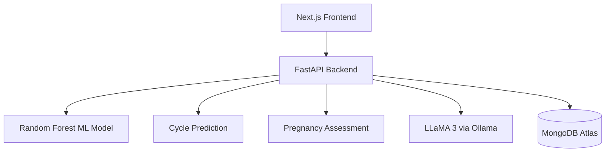

# PCOS Tracker

PCOS Tracker is a full-stack women's health application that combines Machine Learning and Generative AI to help users monitor menstrual cycles, assess potential PCOS risks, track ovulation, and access personalized health information.

## Features

- **PCOS Risk Prediction:** Uses a Random Forest classification model to assess potential PCOS risk based on clinical and lifestyle-related features.
- **Menstrual Cycle Tracking:** Tracks period dates, cycle length, estimated ovulation, and fertile windows.
- **Pregnancy Assessment:** Provides preliminary pregnancy likelihood estimates using menstrual history and conception-related information.
- **AI Health Assistant:** Uses LLaMA 3 through Ollama to generate contextual health guidance based on user cycle information.
- **User Authentication:** Secure user authentication and account management.
- **Health Records:** Stores user profiles, menstrual logs, and assessment history.

## Machine Learning

The PCOS prediction model uses the Random Forest algorithm.

- Dataset: 541 patient records
- PCOS-positive records: 177
- Healthy records: 364
- Input features: 11
- Cross-validation accuracy: 84.10% ± 3.38%
- Cross-validation ROC-AUC: 0.8795
- Hold-out test accuracy: 83.49%

## Tech Stack

| Category | Technologies |
|---|---|
| Frontend | Next.js, React.js, Tailwind CSS |
| Backend | Python, FastAPI |
| Machine Learning | Scikit-learn, Random Forest |
| Generative AI | LLaMA 3, Ollama |
| Database | MongoDB Atlas |
| Authentication | JWT, Bcrypt |
| Streaming | Server-Sent Events (SSE) |

## Project Architecture



## Installation

### 1. Clone the repository

```bash
git clone <your-repository-url>
cd pcos-tracker
```

### 2. Install frontend dependencies

```bash
npm install
```

### 3. Install backend dependencies

```bash
pip install -r requirements.txt
```

### 4. Run the application

Start the backend:

```bash
uvicorn main:app --reload
```

Start the frontend:

```bash
npm run dev
```

Make sure MongoDB Atlas and Ollama are configured before running the application.

## Disclaimer

PCOS Tracker is intended for educational and informational purposes only. Its predictions are not medical diagnoses or a substitute for professional medical advice.

## Author

**Shravani Bhalerao**

[GitHub](https://github.com/smilinngg) | [LinkedIn](https://www.linkedin.com/in/shravani-bhalerao-8b45b5293/)

---

## 👩‍💻 Author

Shravani Bhalerao
